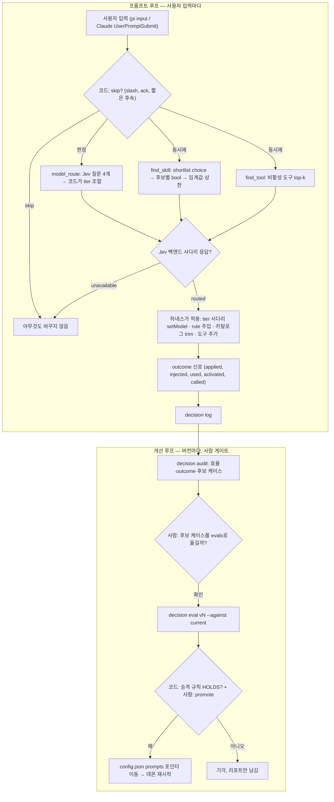

# Product

decision은 pi와 Claude Code가 함께 쓰는 **판정 데몬**이다. 프롬프트 한 건마다 "어떤 모델 tier가 맞나, 어떤 skill·routed rule을 실을까, 어떤 비활성 도구를 켤까, 서브에이전트로 나눌까"를 Jev 판정 모델에게 묻고 **추천만** 돌려준다. 적용(`setModel`, 컨텍스트 주입, 도구 활성화, 서브에이전트 실행)은 각 하네스가 한다. 계획과 측정은 [`docs/plan/261018-decision-model.md`](../docs/plan/261018-decision-model.md)에 있다.

UI가 없는 데몬이라 화면 초안(`page.svelte`)은 만들지 않는다. 여기서 surface는 화면이 아니라 **기능 단위(HTTP 엔드포인트·CLI 명령)**이고, 각 surface의 `intent.json`이 그 기능의 의도를 적는다. 구현은 **Loop → Side → Extra** 순. Extra는 요청 전에 만들지 않는다.

## 의도

| 결정 | 이유 |
| --- | --- |
| **판정은 Jev만** | OpenRouter `typesafe/jev-1.14` → Zen `jev-1.13-free` → Zen `jev-1.13` → `unavailable`. 채팅 LLM 폴백은 쓰지 않는다(사용자 결정). |
| **fail-open** | 데몬이 없거나 느리거나 `unavailable`이면 하네스는 아무것도 바꾸지 않는다. 데몬은 systemd user unit `decision.service`(`127.0.0.1:45130`)가 관리하고, 클라이언트는 띄우지 않는다. |
| **Jev가 판단, 코드가 조합** | 임계값·tier 조합·상한은 `prompts/<feature>/vN.json`의 코드 값이다. 모델 이름은 데몬이 정하지 않는다(tier는 하네스의 `models.profiles` 사다리). |
| **공통 auth 한 곳** | 키는 데몬 안에서만 읽는다(`OPENROUTER_API_KEY`, pi `auth.json`). 하네스와 패키지는 키를 모른다. |
| **버전 승격은 eval로만** | 질문 프롬프트는 버전 파일이고, `config.json` `prompts` 포인터가 현재 버전이다. 기준선 이상일 때만 `decision promote`. |
| **초기 컨텍스트 축소** | always-on rule은 최소로, 나머지는 `rules-routed/`에 두고 프롬프트 의미로 주입한다. skill 카탈로그는 pi `trimCatalog`로 줄인다. |

비범위: 모델 직접 지정, 하네스 대신 적용, 채팅 모델 폴백, 원격 서비스 배포.

```
pi (extensions/decision/) ──┐
Claude Code (plugins/decision/) ─┤  HTTP JSON, timeout 1.5 s, fail-open
decision CLI (eval/audit) ──┘
        ▼
decision.service ─ auth · catalog(skills, rules-routed) · prompts/vN · backends · cache · log
        ▼
~/.local/state/decision/log-YYMMDD.jsonl ──▶ decision audit ──▶ evals 후보 ──▶ decision eval ──▶ promote
```

## Loop

프롬프트마다 도는 판정. 표 순서가 하네스 호출 순서.

| id | 역할 | 엔드포인트 | 현재 버전 |
| --- | --- | --- | --- |
| 01-model-route | 프롬프트가 받을 capability tier(`quick`·`standard`·`high`·`premium`) | `POST /v1/model_route` | v1 |
| 02-find-skill | 실을 skill과 routed rule | `POST /v1/find_skill` | **v2** (`skillThreshold` 0.5) |
| 03-find-tool | 켤 비활성 도구(가산만) | `POST /v1/find_tool` | v1 (v2·v3 기각) |
| ~~04-orchestrate~~ | 보관됨 (`archive/orchestrator/`) | – | – |



## Side

Loop 판정의 품질을 재고 버전을 옮기는 CLI.

| id | 역할 | 명령 | 상태 |
| --- | --- | --- | --- |
| 05-eval | 버전별 오프라인 채점, 리포트 `docs/eval/` | `decision eval --feature f --version vN [--against vM] --all` | 완료. 케이스 model_route 38 · find_skill 47 · find_tool 26 |
| 06-promote | 현재 버전 포인터 이동 | `decision promote f vN` | 완료. find_skill v2 승격 |
| 07-audit | 실사용 log와 transcript 결합, 후보 케이스 | `decision audit --since 7d --harness pi\|claude` | 완료. 7일 사용 뒤 첫 정식 audit 예정 |

## Extra

| id | 역할 | 상태 |
| --- | --- | --- |
| 08-dashboard | dashboard에서 기능별 지연·routed 비율·버전·outcome을 보는 화면 | 요청 전 만들지 않음 |

## 지금까지 구성 (2026-10-18)

| 영역 | 내용 |
| --- | --- |
| 코어 | Bun 데몬 `main.ts serve`, `features/*`(FeatureDef), `catalog.ts`, `engine.ts`, `backends.ts`, `auth.ts`, `eval.ts`, `audit.ts`, `promote.ts`. 계약 `CONTRACTS.md` |
| 카탈로그 | skills `~/.agents/skills/*/SKILL.md`(`_manual` 제외) + 프로젝트 `.agents/skills`, rules `~/.agents/rules-routed` + 프로젝트 `.agents/rules-routed`. 프로젝트가 같은 이름을 이긴다 |
| pi | `~/.pi/agent/extensions/decision/` — model_route 적용, find_skill rule 주입·hint·`trimCatalog`, find_tool 가산 활성화 |
| Claude Code | `~/.agents/plugins/decision/` — `prompt.submit`, `tool.call` mod |
| 측정 | pi merged prompt 35,286 B → 16,929 B (trimCatalog, write-doc 질의). prefetch로 사용자 메시지 전 지연 1.34 s → 0.59 s |
| 열림 | find_tool recall 0.904(목표 0.95 미달), seed 라벨 사용자 검토 전, 7일 audit 전 |
